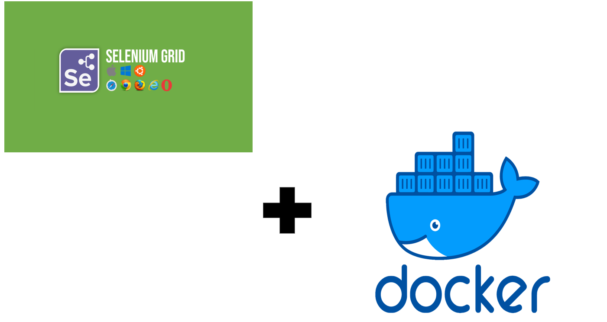

## selenium grid setup and execution with docker

#### This project demonstrates selenium grid execution on docker using : 
- docker-compose  
- docker-compose.yml

### setup and execution

 #### Local Execution
- `git clone <repository url>`
- `mvn clean compile` 
- `mvn test -Dbrowser=chrome -DisRemote=false`

#### Remote Execution
- `git clone <repository url>`
-  `cd ./dependentJar/ && java -jar selenium-server-4.14.1.jar standalone`
- `mvn clean compile` 
- `mvn test -Dbrowser=chrome -DisRemote=true`

#### Execution on Docker based Jenkins container
- Download [docker-desktop](https://docs.docker.com/desktop/)
- `git clone <repository url>`
-  Navigate to the project root
- `docker compose pull`
- `docker compose up -d`
- Navigate to `localhost:4444` (for Selenium grid)
- Navigate to `localhost:8080` (for Jenkins local)

### Notes : Some important Docker commands

- `docker pull jenkins/jenkins:lts : To download Jenkins image`
- `docker image : To get downloaded images`
- `docker ps -a : To get the list of all containers`
- `docker exec -it <docker container id> /bin/bash : Get into docker container`
- To check available images on Docker repo follow the link below:
  - [docker-hub-link](https://hub.docker.com/_/registry/)